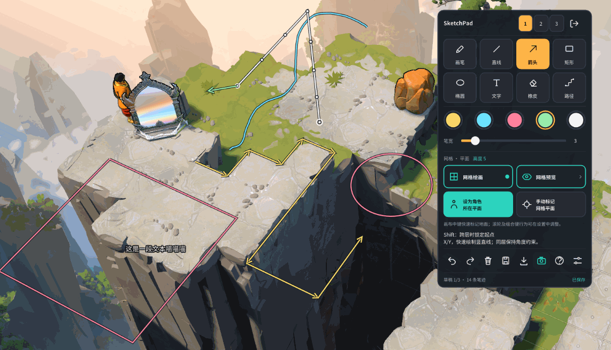
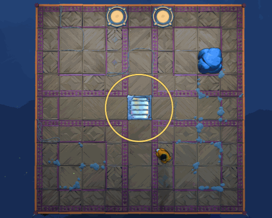
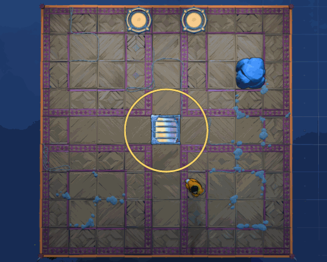
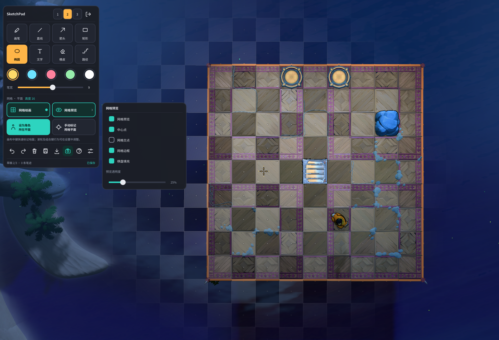
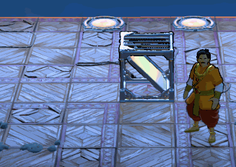
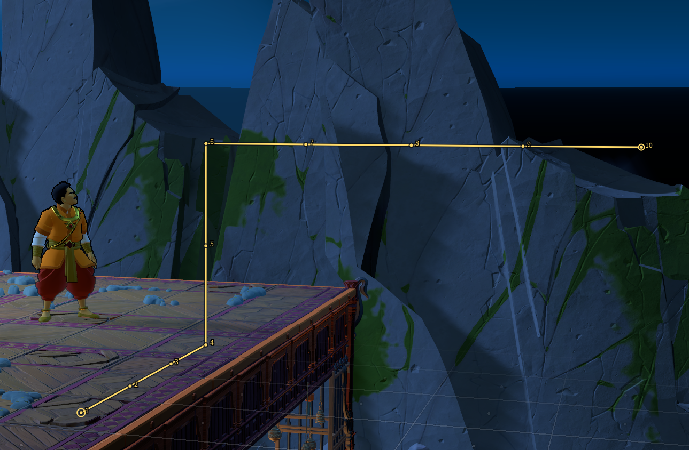
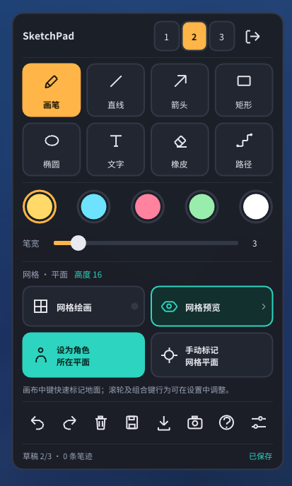
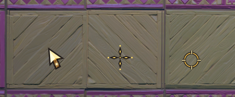

<div align="center">

# SinkingStarSketchPad

**《沉星之序》游戏内画板——把笔记、箭头和路线，直接画进游戏世界里**

转动镜头，你画的标记会像真的画在地上一样，跟着场景一起动。

**简体中文** · [English](docs/README_EN.md)


[核心特色](#核心特色) · [更多功能](#更多功能) · [安装](#安装) · [快捷键](#快捷键) · [常见问题](#常见问题) · [已知限制](#已知限制)

</div>

<p align="center">
<br>
<em>游戏内绘图与世界标记演示</em>
</p>

---

## 简介

SinkingStarSketchPad 是一个《沉星之序》的游戏内画板。你可以一边玩一边在画面上画图、写字、标路线，用来记解谜思路、规划走法。

它以 ReShade 插件的形式运行，不修改游戏文件，装好后在游戏里按 **E** 就能用。

> [!NOTE]
> **Beta 版本。** 网格绘画和地面标记已在部分关卡实测可用。最新的设置、预览和滚轮调整只做过编译检查，还没有在游戏里完整验证。自由相机是实验性功能，请先看[已知限制](#已知限制)。

---

## 核心特色

### 标记画在世界里，不是贴在屏幕上

普通画板把笔迹贴在屏幕上，镜头一动，画的东西就和场景对不上了。

本项目的 **「网格绘画」** 把笔迹画在游戏世界里的一个平面上（比如你脚下这一层地面）。之后不管镜头怎么变，笔迹、箭头、文字都会留在原来的位置，像真的画在地上。

<table align="center" width="680">
<tr>
<td width="50%" align="center"><b>普通绘画：贴在屏幕上</b></td>
<td width="50%" align="center"><b>网格绘画：贴在世界里</b></td>
</tr>
<tr>
<td>

<p align="center">
<br>
<em>普通绘画：笔迹固定在屏幕上</em>
</p>

</td>
<td>

<p align="center">
<br>
<em>网格绘画：笔迹固定在世界里</em>
</p>

</td>
</tr>
</table>

### 三步上手

1. **进入绘图**：按 `E`，点工具栏上的 **「网格绘画」**。
2. **选好平面**：画在哪一层，由你决定。
   - 点 **「设为角色所在平面」**，直接用角色脚下这一层；
   - 或点 **「手动标记」**，再点一下想画的那块地面（鼠标中键可以快速标记一次）。
   - 想换到更高或更低的一层，在画布上**滚动滚轮**，每格升降一格高度。
3. **开始画**。画完随便转镜头看看，标记会跟着场景走。

### 在平面上能做什么

| 你画的东西 | 它在平面上的表现 |
|---|---|
| 画笔、椭圆 | 自由绘制，贴着平面 |
| 直线、箭头、矩形 | 端点自动吸附到格子中心或格线交点，画得整齐 |
| 跨层的直线 / 箭头 | 起点和终点不在同一层时，自动画成一根竖直线，方便标记上下楼 |
| 文字 | 锚点固定在世界里，但文字始终正向显示、大小不变，不会被镜头转歪 |
| 橡皮 | 一次擦掉一整条笔迹 |

每条笔迹都会记住自己是画在哪个平面、用什么颜色和笔宽，互不影响。

打开 **「网格预览」** 可以在鼠标周围看到一片格子，提前知道会吸附到哪一格。升降平面时还会短暂显示新平面的位置。

<p>
<br>
<em>网格预览与吸附点</em>
</p>

<p>
<br>
<em>跨层竖直线与辅助落点演示</em>
</p>

更完整的规则见 [网格绘画说明](docs/GRID_DRAWING.md) 和 [地面标识说明](docs/MANUAL_GROUND.md)。

---

## 更多功能

### 格子路径

沿格子中心点出一条路线，适合标记「怎么走」。

- 点格心开始，沿 X、Y、Z 任一方向点下一个点，**中间的格子会自动补齐**；
- 转弯处先加一个点，不能直接斜着跨格；
- 滚轮改高度后可以接竖向路段（上下楼）；
- 可开启 **「路径计数」**，自动给每个路径点编号，每条新路径从 1 重新开始；
- 路径会固定在原来的格子上，镜头怎么变都不会漂；支持撤销。

<p>
<br>
<em>格子路径与路径计数</em>
</p>

> 这个工具**只负责标记**，不会检查障碍、自动寻路，也不会替你移动角色。

### 自由相机（实验性）

按 `T` 打开，可以脱离游戏默认视角，自己平移、旋转、升降镜头，从别的角度看关卡。配合网格绘画，很适合在俯视角度规划路线。

| 操作 | 按键 |
|---|---|
| 地面平移 | `W` `A` `S` `D` |
| 升高 / 降低 | `Q` / `Z` |
| 加速 | 按住 `Shift` |
| 旋转、俯仰 | 按住鼠标右键拖动 |
| 缩放 | 关闭绘图后滚动滚轮 |
| 退出并恢复游戏视角 | `T` 或 `Esc` |

<details>
<summary>自由相机的更多细节</summary>

- 每次启动游戏默认关闭，需要先进入关卡，等插件识别到游戏主相机后才能用。
- 相机面板里有 X / Y / 高度偏移、旋转、俯仰、缩放，以及「重置到当前游戏相机」。
- **反转鼠标 X / Y 轴** 两个开关互相独立：X 控制右键横向拖动的方向，Y 控制纵向拖动的方向，不影响 WASD 和滚轮。默认 X 关闭、Y 开启。
- 移动速度（默认 5）、鼠标灵敏度和两个反转开关会自动保存，重启后仍保留。
- **「固定相机」按钮**：保留当前机位并把键鼠还给游戏；之后按 `T` 可继续调整，按 `Esc` 或「恢复游戏视角」归位。机位不跨重启保留，切换关卡会清除。
- 相机开启时，WASD 不再移动角色；输入文字时相机快捷键暂停。
- 检测到场景或原相机大幅跳变时，可能自动关闭。

</details>

### 绘图工具

画笔、直线、箭头、矩形、椭圆、文字、整笔橡皮，加上五种笔色。按住 `Shift` 可以约束成 45° 直线、正方形或正圆。支持撤销 / 重做（每页 60 步）。

<p>
<br>
<em>绘图工具栏</em>
</p>

### 三页草稿与导出

- 三页独立草稿，`Ctrl+1 / 2 / 3` 切换，自动保存；
- 每页可以各自固定一个平面，建议**不同关卡用不同的页**；
- 可以导出 **SVG**（工具栏「导出 SVG」）。

### 主题光标

- 平时：浅金色晶刃指针，带星芒刻纹；
- 绘图时：镂空星芒准星，颜色跟随当前笔色；
- 橡皮：镂空符文圆环。

<p>
<br>
<em>晶刃指针、星芒准星与符文圆环橡皮</em>
</p>

### 中英文界面与界面缩放

- 在 **设置 → 语言 / Language** 里选 System、English 或简体中文，立即生效，重启后保留；
- **设置 → 界面缩放** 可在 75%–200% 调整所有窗口和提示的大小，点「应用缩放」后生效；
- 笔迹、文字标注和网格不会跟着缩放。

---

## 安装

**需要**：Windows 64 位，DirectX 12 版《沉星之序》。从 [Releases](https://github.com/wdsjjszr/SinkingStarSketchPad/releases) 下载发布包。

本包是**手动复制安装**，不需要运行任何安装程序或脚本。

**首次安装（电脑上没有其他 ReShade / 图形代理）：**

1. 保存进度，**完全退出游戏**。
2. 解压发布包，把 `game_files` **里面的内容**复制到 `sinking_star.exe` 所在的文件夹。
   注意是复制里面的内容，不是把 `game_files` 文件夹整个丢进去。
3. 启动游戏，按 **E** 打开绘图。

<details>
<summary>复制完成后，游戏目录应该长这样</summary>

```
sinking_star.exe
dxgi.dll
SinkingStarSketch.addon64
ReShade.ini
Sketch-ReShadePreset.ini
SinkingStarSketch-assets/
  NotoSansCJKsc-Regular.otf
  NotoSansCJKsc-Bold.otf
```

</details>

<details>
<summary>从旧版升级</summary>

1. 先把旧插件、字体、`ReShade.ini` 和 `SinkingStarSketch-data` **备份到游戏目录之外**。
2. 复制新的插件和字体，保留原来的草稿、偏好和配置。
3. 打开 `ReShade.ini`，在已有的 `[INPUT]` 节里把 `InputProcessing` 改为 `1`（不要重复添加这一项）。如果没有这一节，就添加：

```ini
[INPUT]
InputProcessing=1
```

这个值让键盘和鼠标分开处理：`2` 会在绘图时继续屏蔽键盘，`0` 会让绘图用的鼠标操作影响游戏。安装包不会自动备份、改配置或检查冲突，需要你自己完成上面的步骤。

升级后如果中文缺字，请看下面「已有安装的字体配置」。

</details>

<details>
<summary>我已经装过 ReShade 或其他图形代理</summary>

不要覆盖你原来的运行库。只复制插件和字体，保留现有配置，手动把 `[INPUT] InputProcessing` 设为 `1`，并确认 ReShade 会从游戏目录加载插件。详细说明见英文文档 [Existing ReShade installations](docs/README_EN.md#existing-reshade-installations)。

本版只验证过随包附带的 **ReShade 6.8.0** 完整插件运行库。

</details>

<details>
<summary>已有安装的字体配置（中文缺字时看这里）</summary>

在 `ReShade.ini` 的 `[STYLE]` 中设置：

```ini
[STYLE]
Font=.\SinkingStarSketch-assets\NotoSansCJKsc-Regular.otf
LatinFont=.\SinkingStarSketch-assets\NotoSansCJKsc-Regular.otf
FontSize=18
EditorFont=.\SinkingStarSketch-assets\NotoSansCJKsc-Bold.otf
EditorFontSize=18
```

重启游戏后生效。只替换插件不会改动你已有的 ReShade 字体配置。缺少粗体文件或相关配置时，会退回普通字体。

</details>

---

## 快捷键

鼠标悬停在工具栏图标上会显示名称和快捷键；点工具栏的「快捷键说明」可以打开一个可拖动的完整说明窗口。

| 操作 | 按键 |
|---|---|
| 进入 / 退出绘图 | `E` |
| 画笔 / 直线 / 箭头 | `Alt+P` / `Alt+L` / `Alt+A` |
| 矩形 / 椭圆 / 文字 | `Alt+R` / `Alt+O` / `Alt+T` |
| 整笔橡皮 / 格子路径 | `Alt+K` / `Alt+H` |
| 五种笔色 | `Alt+1` – `Alt+5` |
| **升高 / 降低绘图平面** | 在画布上滚动滚轮（可在设置里改） |
| 循环切换笔色 / 工具 | `Shift+滚轮` / `Alt+滚轮` |
| 临时橡皮 | 按住鼠标右键 |
| 约束 45° 直线 / 正方形 / 正圆 | 按住 `Shift` |
| 撤销 / 重做 | `Ctrl+Z` / `Ctrl+Y` |
| 切换草稿页 | `Ctrl+1` / `Ctrl+2` / `Ctrl+3` |
| 保存 / 清空本页（可撤销） | `Ctrl+S` / `Ctrl+Shift+Delete` |
| 完成文字输入 | `Ctrl+Enter` |
| 取消当前笔画或文字，否则返回游戏 | `Esc` |
| 自由相机 | `T` |
| 隐藏 / 显示指针，隐藏 / 显示草稿 | `G` / `B` |

<details>
<summary>操作小提示</summary>

- 直线、箭头、矩形、椭圆除了拖动，也可以「点起点、再点终点」；右键取消还没完成的图形。
- 绘图时，普通键盘输入仍然交给游戏，所以你可以边画边走位、转镜头；**鼠标则由画板接管**，想用游戏里的鼠标时按 `E`。
- 打开文字输入框，或按住 `Ctrl` / `Alt` 使用 Mod 组合键时，键盘会暂时由 Mod 接管。
- `E` / `G` / `B` 只在没有按 `Ctrl` / `Shift` / `Alt`、且没有文字输入框时生效。
- 切出游戏窗口时，会保留绘图模式和没写完的文字，并保存已完成的笔迹；切回来后先松开鼠标按键再继续，避免把切换窗口的那一下点击画进草稿。
- 已核对过游戏默认键位，如果你自定义了游戏按键，可能和上面的快捷键冲突。

</details>

---

## 常见问题

**进游戏后没有工具栏？**
确认文件复制到了实际运行的 `sinking_star.exe` 旁边，完全重启游戏后再按 `E`。

**网格或相机一直显示「等待」？**
进入一个普通关卡，稍等片刻。不要默认屏幕上任意一片网格就是真实地面。

**升级后中文显示缺字？**
检查保留下来的 `ReShade.ini`，在 ReShade 字体设置里选 `SinkingStarSketch-assets/NotoSansCJKsc-Regular.otf`，或参考上面的字体配置。

**想反馈问题，该附什么？**
日志在游戏目录的 `ReShade.log` 和 `SinkingStarSketch-data/status.txt`。公开提交前请先检查里面有没有你的个人路径。

---

## 已知限制

- **自由相机只改渲染出来的画面，不改游戏本身的相机。** 游戏内部的裁剪、阴影、反射、物体加载和鼠标选取仍可能按原视角计算。大幅平移、压低角度，或看向原本看不到的区域时，可能缺少物体或出现画面异常。它不会解锁未加载的区域，也不会暂停游戏。
- **格子路径只标记**，不检查障碍，不自动寻路。
- **平面不会自动跟随关卡。** 换关卡后三页会重新读取平面，已经画好的路径保留各自的格子；不同关卡请自己用不同的草稿页。
- 遮挡判断只考虑游戏原生的实心墙体，不含装饰模型、升降台、莲叶等。
- 特殊斜面、多层楼层、过渡镜头、环绕地图，以及游戏更新之后的表现，需要在游戏里实际核对。

---

## 数据、导出与卸载

<details>
<summary>草稿和设置存在哪里</summary>

- 草稿：`SinkingStarSketch-data/drafts.txt`，上一版自动备份为 `.bak`；
- 设置（语言、相机、网格绘画、预览等偏好）：同目录的 `settings.ini`；
- 导出的 SVG：`SinkingStarSketch-data/exports/`。没有有效相机时，世界里的笔迹会被省略，没画完的图形也不会导出；
- 每页最多 2000 条笔迹、合计 120000 个点；撤销历史不会跨重启保存。

**草稿格式已升级为 v5**，仍能读取 v1–v4。升级时会生成不覆盖的 `drafts.pre-v5.txt` 作为备份；备份失败会停止保存。旧版插件读不了 v5，如需降级，请先恢复这份备份。

语言设置文件示例（`Language` 可填 `zh-CN`、`en` 或 `auto`）：

```ini
[Interface]
Language=zh-CN
```

</details>

<details>
<summary>卸载</summary>

退出游戏，把 `SinkingStarSketch.addon64` 移到游戏目录之外即可停用。保留 `SinkingStarSketch-data` 就能留下草稿、偏好和导出文件。

如果还想移除首次安装时附带的 ReShade：先确认没有其他 Mod 在共用它，再把 `dxgi.dll`、`ReShade.ini` 和字体资源移出游戏目录。原来的图形设置可以从备份恢复。不需要卸载脚本。

</details>

<details>
<summary>从源码编译</summary>

需要 64 位 Windows。

1. 从 [LLVM-MinGW 发布页](https://github.com/mstorsjo/llvm-mingw/releases/tag/20261006) 下载 `llvm-mingw-20261006-ucrt-x86_64.zip`，保留顶层目录，解压到项目根目录的 `.tools/`，使编译器位于 `.tools/llvm-mingw-20261006-ucrt-x86_64/bin/clang++.exe`；
2. 在项目根目录的 PowerShell 中运行：

```powershell
.\build.ps1
.\test.ps1
```

产物为 `build/SinkingStarSketch.addon64`。`test.ps1` 只做静态编译检查，不会运行程序。可以用 `-Compiler '其他路径\clang++.exe'` 指定别的编译器。`.tools/` 和 `build/` 已被 Git 忽略。

ReShade 的编译头文件已包含在仓库中，不需要安装 Visual Studio，也不用改系统 PATH。真正在游戏里验证，还需要兼容的 ReShade 运行库、字体和游戏环境。

</details>

---

## 文档

- [English README](docs/README_EN.md)
- [网格绘画说明](docs/GRID_DRAWING.md)
- [地面标识说明](docs/MANUAL_GROUND.md)
- [第三方组件说明](THIRD_PARTY_NOTICES.md)

---

## 关于本项目

本项目是 [ouyangzhixuan/SinkingStarSketchPad](https://github.com/ouyangzhixuan/SinkingStarSketchPad) 的 fork，由 **wdsjjszr** 维护。

- 插件文件名 `SinkingStarSketch.addon64`、草稿与字体目录仍沿用原名，这样升级后可以继续使用已有的数据和偏好。
- 本工具与游戏官方无关，也没有分发从游戏中提取的文件或美术资源。
- 代码、界面和翻译中包含生成式 AI 生成的内容。

### 许可

源码和文档采用 **MIT** 许可证。原作者版权保留；fork 修改部分版权归 2026 wdsjjszr 所有，同样采用 MIT。

随包分发的第三方组件各自遵守自己的许可：ReShade（BSD 3-Clause）、Dear ImGui（MIT）、Noto Sans CJK（SIL OFL 1.1）、LLVM-MinGW 运行时。许可全文见发布包中的 `licenses` 目录。
