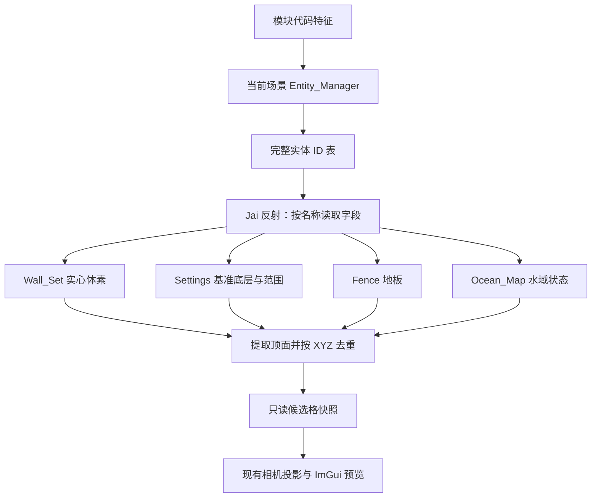

# 原生地面格 Debug 预览：实验技术说明

记录日期：2026-10-24。实现基线：Native Ground Debug Fix1，提交 `3ea7253`。本文记录已实现的数据链路、关键修复与验证结论；操作方式见 [手动地面与 Debug 使用说明](MANUAL_GROUND.md)。

## 1. 实验目标与结果

本次实验验证：通过当前场景的原生逻辑数据，能否直接得到不同高度上的地面格位置，并投影到游戏画面中供人工检查。

Fix1 交付后，用户反馈：“在我测试的关卡中，都能够正确的显示网格。”这支持将原生数据读取作为后续手动选择地面的数据基础。人工验证的关卡清单与数量未逐项记录，结论限定于用户已测关卡；尚不能扩展为全游戏及所有特殊地形均已覆盖。

当前交付是独立的 Debug 预览，已有自动识别、手动锚定与路径绘制仍使用原来的数据链路。原生格尚未参与鼠标点选，也没有接入深度遮挡判定。

## 2. 为什么更换坐标来源

旧链路观察 D3D12 上传缓冲，将符合筛选条件的 3×4 实例矩阵平移部分作为输入点，再按高度分组、估计格距并评分。输入点代表疑似实例原点，不保证对应地面表面：

- 静态地形不一定以独立、单位缩放实例提交，也不保证经过已观察到的上传路径。
- 实体原点可能位于模型底部，无法直接代表地形表面。
- 缓存的上传区域、非主场景数据及坐标空间差异，都可能产生无关候选；此前悬空点的具体成因未逐一确认。
- 评分只能筛选输入点中的规则排列，无法补出从未采集到的地面。

新链路直接读取逻辑体素、基准底层和地板数据。格距采用游戏正常移动一格对应的 **1 世界单位**，不同高度共用世界 X/Y 网格，不再逐层估计格距。一个原生格就可以成为候选，不需要满足旧识别器的六点与二维邻接门槛。

## 3. 数据链路与代码入口



| 文件 / 入口 | 职责 |
| --- | --- |
| [native_ground_bridge.hpp](../src/native_ground_bridge.hpp)：`Reader::initialize/sample` | 定位当前场景、枚举实体、解析反射字段并读取原生数据 |
| [native_ground.hpp](../src/native_ground.hpp)：`add_wall/surfaces` | 展开体素位图，生成、去重候选地面格 |
| [addon.cpp](../src/addon.cpp)：`draw_native_ground_debug`、`controls`、`overlay` | 开关、选层、投影、悬停提示与状态记录 |
| [i18n.hpp](../src/i18n.hpp) | 中英文界面文字 |
| [native_ground_tests.cpp](../tests/native_ground_tests.cpp) | 候选生成的断言用例；本次只做语法检查，未执行程序 |

插件直接读取自身所在游戏进程，不依赖控制台常驻或进程间通信。游戏 EXE、关卡包与临时反汇编仅用于前期静态分析，不随插件分发。

## 4. 当前场景与完整实体枚举

### 4.1 场景入口

参考 ootss-cmd，在主模块 `.text` 中匹配当前场景的 RIP 相对引用，解码有符号 `disp32`：

```text
特征：4C 8B 2D ?? ?? ?? ?? 49 8D 95 98 3D 00 00
      4D 8D 85 B0 3D 00 00 31 C9 E8 ?? ?? ?? ??

scene_slot = 匹配指令地址 + 7 + sign_extend(disp32)
manager    = read_pointer(scene_slot)
```

这里定位的是当前场景全局指针槽。模块基址随加载变化，运行时不直接使用静态分析中的绝对地址。类型字段从模块 `.rdata` 的 Jai 反射信息解析。

### 4.2 `No Settings entity in this scene` 的根因

初版沿用了控制台寻找角色时使用的 `manager + 0x370/+0x378` 对象列表。该列表受类型分支影响，不包含全部场景对象，因此不能用于完整地形读取。

用户在 `cliff_hopping` 复现了 `No Settings entity in this scene.`。状态文件能读出正确关卡名；静态解析该关卡文件也能找到 `Settings 51380225`，其网格为 25×24。问题是枚举入口漏掉对象。

静态分析确认，游戏注册实体时先将实体 ID 与指针写入完整 ID 表，之后才按类型决定是否加入其他对象列表。Fix1 因而改用完整 ID 表，覆盖 Settings 和静态地形。

以下为本次目标零售版的布局，均以 `manager` 或槽首地址为基准：

| 位置 | 含义 |
| --- | --- |
| `manager + 0x00` | 场景资源名，Jai 字符串：count、data |
| `manager + 0x398` | 完整实体 ID 表结构起点 |
| `manager + 0x3C0` | ID 表槽数组长度，包含空槽与删除槽，不是有效实体数 |
| `manager + 0x3C8` | 槽数组指针；每槽 16 字节 |
| `slot + 0x00` | 32 位 hash；小于 2 的槽跳过 |
| `slot + 0x08` | 实体指针；空指针跳过 |
| `entity + 0xF0` | 所属场景管理器，用于核对对象归属 |
| `entity + 0x108` | Jai 类型描述符指针，用于识别实体类型 |

槽步长、指针位置及空槽/删除槽判定都有编译期断言。读取末尾再次核对当前场景指针与槽数组头部；失败快照清除候选并返回原因，不沿用上次成功结果。

### 4.3 字段解析

反射描述提供结构体大小、成员名称、成员类型和相对偏移。读取器按名称逐层解析，例如：

```text
Wall_Set.wall_data.bits.slots
Settings.grid.corner
Fence.is_floor
entity.undoable_data.position
```

Jai 类型头的结构体标记为 7，类型大小位于 `+8`，名称位于 `+16`；成员数组 count/data 位于 `+64/+72`。每个成员描述占 64 字节，名称、类型指针、字段偏移和 flags 分别从 `+0/+16/+24/+32` 读取。

实体 ID 表位置、实体头部入口和反射格式仍是本次版本对应的布局约定；按名称解析字段不等于所有结构变化都能自动兼容。代码保留必要的地址、长度和字段大小检查，不通过时明确报告错误。

## 5. 不同高度地面格的构造

### 5.1 Wall_Set：实心体素的暴露顶面

读取 `kind == WALLS` 的 `wall_data.corner`、`dimensions`、`bits.slots` 与 `bits.count`。`OCEAN_HOLE` 类型不作为实心墙体展开。位图按 X 最快、然后 Y、最后 Z 的顺序存储：

```text
n        = i + size_x × (j + size_y × k)
occupied = (slots[n / 64] >> (n % 64)) & 1
q(v)     = floor(v + 0.5)

体素世界坐标 = q(Wall_Set.position) + wall_data.corner + (i, j, k)
```

所有 Wall_Set 合并到同一份实心体素集合。对实心格 `(x,y,z)`，只有上方 `(x,y,z+1)` 不实心时，才生成格心 `(x,y,z+1)`；因此也会去掉跨 Wall_Set 相邻体素间的内部顶面。格子的水平边界为格心 X/Y 各加减 0.5。

当前按逻辑位置与位图重建轴对齐体素，不另施加模型旋转或缩放。顶面集合包含墙顶，不能单凭它判断角色是否能到达。

### 5.2 Settings：隐式基准底层

读取 `grid` 的范围、`ground_z0`、`underground_z0`、`has_lower_layer` 及地层分界高度。在 Settings 网格范围内生成地表基准格；启用下层时，另生成地下基准格。天空层不生成隐式底层。

候选格会剔除自身被实心体素占用、或命中相应水域的位置。这些格是逻辑参考平面，可能覆盖没有可见地形的位置；不能用它们反推装饰地形轮廓。

### 5.3 Fence：自身所在格的地板

只在 `blocking` 与 `is_floor` 同时为真时生成地板候选。X/Y 按 `q(v)` 对齐格心，Z 保留逻辑位置；自身格被实心体素占用时不生成。

### 5.4 Ocean_Map：过滤基准底层的水域

读取运行时 `ocean_values`，其 bit 0 表示水域存在；索引由 Ocean_Map 逻辑位置、局部 grid corner 和宽高换算，局部环绕按 grid 配置处理。水域与候选需位于同一基本地层，并满足 `ocean.z <= candidate.z + 2.1`。

水域数据在本版只用于过滤基准底层。水面本身不生成可站立地面格，也不直接删除体素顶面与 Fence 候选。

### 5.5 状态与去重

读取时跳过待销毁实体，以及存在组中当前不存在的实体。不会仅因 `INVISIBLE` 标记丢弃对象，因为不可见的逻辑碰撞体仍可能定义有效地形。

候选按完整 `(x,y,z)` 去重，同一 XY 可以保留多个 Z。完全重合时，当前写入顺序使 Fence 地板优先于体素顶面，体素顶面优先于基准底层。每条结果保存格心、来源类别和实体 ID；基准底层的实体 ID 为 0。

## 6. 快照、显示与诊断

后台线程默认等待。开启原生 Debug 后进行读取，完成后等待约一秒再采样，通过 `shared_ptr<const Snapshot>` 发布给绘制线程；关闭后停止后续采样并清除发布结果。读取过程中不写入游戏内存。

绘制使用项目现有相机投影，包括自由相机的有效投影，不单独估计屏幕格距。颜色由世界 Z 决定；实心点表示体素顶面，空心圈表示基准底层，十字表示 Fence 地板。高度筛选与悬停来源提示用于人工核对。

`native_ground_visible` 统计通过高度筛选且格心投影位于屏幕内的候选数量，不代表通过了场景遮挡判断。预览由 ImGui 覆盖层绘制，会穿过墙体、角色等前景对象。

菜单显示原始来源数量；`SinkingStarSketch-data/status.txt` 记录：

| 字段 | 用途 |
| --- | --- |
| `native_ground_debug`、`native_ground_ready` | 开关与快照是否读取成功 |
| `native_ground_scene` | 当前读取的场景名 |
| `native_ground_cells`、`native_ground_heights` | 去重后的总格数与高度数 |
| `native_ground_visible` | 屏幕内且符合高度筛选的格数 |
| `native_ground_voxels` | 合并后的实心体素数 |
| `native_ground_error` | 当前读取失败原因 |

## 7. 验证范围与后续接入边界

| 验证来源 | 已完成内容 | 结论范围 |
| --- | --- | --- |
| 开发侧静态分析 | EXE 类型信息、实体注册/枚举代码、关卡文件结构 | 为字段读取、ID 表布局和位图展开提供依据 |
| 开发侧静态检查与编译 | C++ 语法检查、编译期断言、插件编译链接 | 代码可编译；未执行测试程序或游戏 |
| 用户人工验证 | 安装 Fix1 后检查多个关卡中的网格显示 | 用户确认已测关卡显示正确；未提供逐关清单与数量 |

仍未覆盖或验证的部分：

- 前景物体遮挡、鼠标最终命中层及点击交互；原生候选尚未接入手动锚定。
- 升降台、莲叶、角色或石头等额外支撑来源，以及世界环绕的额外渲染副本。
- 完整角色支撑/移动规则、技能条件与可达性；当前候选生成没有复刻 `supported_at` 的全部行为。
- 变换地形、全部特殊关卡及不同游戏版本；大场景预览的帧率也未做量化测量。

本次结果支持复用 **当前场景原生候选格 + 现有相机投影**。后续鼠标选择可以在这些有限格子上做射线求交并保留重叠高度；场景深度用于处理前景遮挡的方案仍待实现和验证。基准底层的来源标记应继续保留，避免将逻辑参考平面误认为可见地形表面。

## 8. 关键提交与参考

| 提交 | 内容 |
| --- | --- |
| `5cc5b95` | 原生场景、反射字段、体素与候选地面格读取 |
| `a0fe53f` | 按高度着色、选层、悬停与状态记录 |
| `3ea7253` | 改用完整实体 ID 表，修复 Settings 与静态对象遗漏 |

- [ootss-cmd 场景定位源码](https://github.com/qiekn/ootss-cmd/blob/main/src/game/memory.jai)：当前场景代码特征与实体入口参考。
- [ootss-cmd 反射字段解析](https://github.com/qiekn/ootss-cmd/blob/main/src/game/position_layout.jai)：按名称查找 Jai 结构字段的参考。
- [joric/ootss Progression Rules](https://github.com/joric/ootss/wiki/Progression-Rules)：体素支撑、隐式底层、地层、水域与地板行为的调查线索。Wiki 中查看器的可达性模型不能当作本插件已实现的功能。
- [joric/ootss simp_tool.py](https://github.com/joric/ootss/blob/main/scripts/simp_tool.py)：前期静态读取 EXE 类型信息和解析关卡文件的参考工具。
- [第三方来源说明](../THIRD_PARTY_NOTICES.md)。

临时 schema、关卡解析结果和反汇编记录保留在已忽略的 `.local-docs/`，不属于插件运行依赖。本文作为实现技术说明随源码保留。
